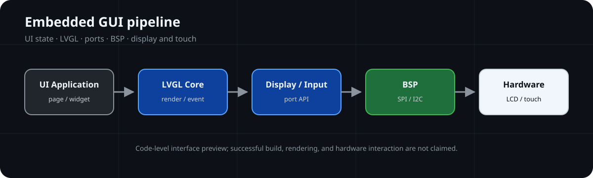

# LVGL Embedded GUI Lab

A real LVGL v9.6.0 host dashboard with a 240 × 280 logical display, a portable C state model, an SDL2 window, and a deterministic headless renderer. Samples are synthetic; this repository has no MCU display or touch driver.



## Build and run

Prerequisites: CMake 3.20+, C/C++ compiler, and Ninja or another CMake generator. For the interactive window, install SDL2 development files and `pkg-config` (Ubuntu: `libsdl2-dev pkg-config`). Clone with submodules or run `git submodule update --init --recursive`. The submodule pins the [official LVGL commit](https://github.com/lvgl/lvgl/commit/80ca777e37a2b176770726a02e07a6fb79ef0b39). See [third-party notices](THIRD_PARTY_NOTICES.md).

```sh
cmake -S . -B build -G Ninja -DDASHBOARD_ENABLE_SDL=ON
cmake --build build --parallel
./build/dashboard_demo
ctest --test-dir build --output-on-failure
```

On Windows with MinGW, use `build/dashboard_demo.exe`. If SDL2 is unavailable, omit `-DDASHBOARD_ENABLE_SDL=ON`: the headless LVGL tests still build and run. On a desktopless Linux runner, use `xvfb-run -a ctest --test-dir build --output-on-failure` for the SDL smoke test. The bounded smoke mode is `./build/dashboard_demo --smoke`.

To run the three real-renderer scenarios and save frames:

```sh
mkdir -p artifacts
./build/dashboard_headless normal artifacts/normal.ppm
./build/dashboard_headless fault artifacts/fault.ppm
./build/dashboard_headless interaction artifacts/diagnostics.ppm
```

`normal` checks UNKNOWN → HIGH → LOW and changing LVGL pixels; `fault` checks invalid sample retention, visible FAULT, recovery and resume; `interaction` presses and releases the LVGL pointer on Pause, Resume and navigation, then sends a Reset event. The tests check actual widgets, active screen, flush count, pixel bounds and framebuffer changes. PPMs are generated locally and ignored by Git; CI uploads them as artifacts.

## Application contract

The model in `app/dashboard_model.c` has no LVGL or platform dependency. Valid inputs are 0..4095. Thresholds require `low < high`. The initial level is UNKNOWN; the middle band retains the prior level. Invalid input while running latches FAULT without replacing the last valid sample. Recover clears the fault and enters PAUSED; Resume restarts sampling. Reset clears sequence, counters, last value and level while retaining thresholds. Counters saturate at `UINT32_MAX`. Paused and faulted models do not accept samples.

The GUI owns all LVGL objects in a single thread. The SDL loop advances `lv_tick_inc()` and calls `lv_timer_handler()` every 20 ms. A synthetic sample is offered every 500 ms only while running. Headless tests use the same UI and handler with a 240 × 280 XRGB8888 display, a 40-line draw buffer and a checked flush callback. The UI refresh function reports invalid handles.

The dashboard shows ADC value, LOW/HIGH/UNKNOWN, RUNNING/PAUSED/FAULT, sequence, last error and a bar. Pause/Resume/Recover, Reset and Fault are actual event-driven controls. Diagnostics is a separate screen with status, last error, accepted/rejected counts and last valid sample. Fault injects an out-of-range synthetic sample; it is not a hardware fault.

## Scope and evidence

GitHub Actions builds GCC and Clang with SDL2, runs all tests plus an SDL window smoke under Xvfb, and separately runs ASan/UBSan over the model and real LVGL headless integration. The historic v8.3.11 porting notes in `docs/` describe a future GD32F407VE / ST7789 / CST816T / FreeRTOS target; they are not a v9 implementation or target validation. The replacement points are the SDL display, pointer and main loop. Target work still needs real display/touch adapters, buffer and DMA lifetime analysis, a GUI task ownership rule, toolchain build and board verification. No board, HEX, touch or FreeRTOS target result is claimed.

The repository's original documentation and SVGs remain. No course UI, SquareLine output, unknown-rights bitmap font, vendor source or third-party image is included in the dashboard. See [provenance and scope](docs/provenance-and-scope.md), [development environment](docs/development-environment.md), and [third-party notices](THIRD_PARTY_NOTICES.md).
